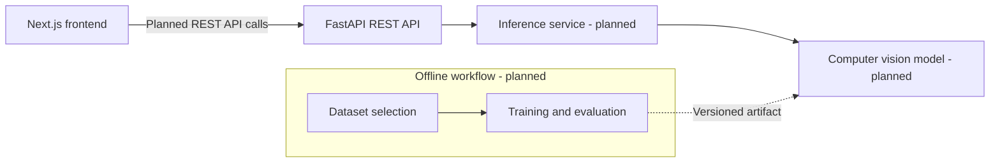

# HORTI

HORTI is a smart agriculture portfolio project exploring plant disease detection through
computer vision, with crop monitoring as a future goal. It aims to turn a leaf photograph
into a model prediction and useful, reviewed plant-health information.

> Currently in development: backend and frontend foundations are in place; disease prediction is planned.

## Overview

The intended application will let users upload a leaf image, view a predicted class and
confidence score, and read sourced information about the possible disease. The first MVP
will focus on a small, documented set of crops and classes, with clear uncertainty warnings.
The current application provides a static landing page and a health-check API.

## Motivation

HORTI started from a personal connection to agriculture. My father works as an
agricultural technician, so I grew up around his practical knowledge of crops, plant
health, and the challenges faced in agriculture.

As a Computer Science student, I wanted to connect his agricultural experience with
what I am learning in software development and artificial intelligence. HORTI explores
how computer vision and software could support plant-health monitoring and, eventually,
other agricultural applications.

The project gives me practical experience in machine learning, backend engineering,
API design, testing, and deployment while working on a problem with personal meaning.

## Current Progress

### Implemented

- FastAPI application factory with a `GET /health` endpoint and generated API documentation.
- Validated environment settings and a configurable CORS origin allowlist.
- Static Next.js landing page using strict TypeScript and Tailwind CSS.
- Backend health/CORS test cases, dependency locks, and lint/type-check tooling.
- GitHub Actions workflow definition for backend checks and frontend builds.

Frontend lint, type checks, and production build have been validated. Backend runtime
validation and remote CI verification remain pending; see the [validation record](docs/VALIDATION.md).

### In Progress / Planned

- Safe image uploads, validation, and shared training/inference preprocessing.
- Dataset selection, a reproducible ML baseline, training, and held-out evaluation.
- Model inference with class scores, uncertainty handling, and reviewed disease information.
- Accessible upload/results screens and frontend-to-API integration.
- End-to-end testing and deployment after the local MVP is complete.

No dataset or model has been selected, and no prediction pipeline is implemented.
Database features, accounts, prediction history, mobile clients, and crop monitoring are
future work.

## Planned MVP

1. Upload one leaf image through the web interface.
2. Validate the image and apply the model's preprocessing.
3. Run inference using a versioned computer vision model.
4. Return the predicted class, confidence score, and uncertainty information.
5. Display reviewed plant-health information with source links.

This flow is planned and does not yet work end to end.

## Tech Stack

| Area | Technologies |
| --- | --- |
| Backend | Python 3.12, FastAPI, Pydantic, Uvicorn |
| Frontend | Next.js App Router, React, strict TypeScript, Tailwind CSS |
| Machine learning (planned) | PyTorch, Torchvision, Pillow, scikit-learn; optional ML dependencies declared |
| Persistence (planned) | SQLAlchemy, Alembic, SQLite locally; PostgreSQL later |
| Testing / tooling | pytest, Ruff, ESLint, uv, npm, GitHub Actions workflow |

## Architecture

The planned prediction flow keeps HTTP routes separate from validation and inference
logic. Training runs offline and produces versioned model artifacts; the API will perform
inference only.



The frontend and API foundations exist; their prediction integration and the ML components
are planned. See [Architecture](docs/ARCHITECTURE.md) for the full design.

## Project Structure

```text
HORTI/
  backend/     FastAPI application and API tests
  frontend/    Next.js web interface
  ml/          Workspace documentation for planned ML work
  docs/        Architecture and validation records
  scripts/     Foundation validation script
  README.md    Project overview and local setup
  SPEC.md      Requirements and acceptance criteria
  TASKS.md     Implementation checklist
  ROADMAP.md   Major milestones
```

## Running Locally

Install Python 3.12, [uv](https://docs.astral.sh/uv/), and Node.js 22+ with npm.
Run these commands from the repository root:

```sh
uv sync --project backend --locked
npm --prefix frontend ci
```

Optionally copy `.env.example` to `.env` if that file does not already exist, to enable
the local frontend origin in CORS. The backend otherwise uses default settings.

Start the backend:

```sh
uv run --project backend --locked uvicorn app.main:app --reload --app-dir backend --host 127.0.0.1 --port 8000
```

Start the frontend in a second terminal:

```sh
npm --prefix frontend run dev
```

Open [the frontend](http://localhost:3000) and [API documentation](http://127.0.0.1:8000/docs).
The health endpoint at `http://127.0.0.1:8000/health` is defined to return `{"status":"ok"}`.
The landing page does not yet call the API. No GPU, dataset, or database server is required.

For existing environment restrictions and validation commands, see
[Validation](docs/VALIDATION.md). In Windows PowerShell, use `npm.cmd` if `npm` is blocked
by execution policy.

## Roadmap

- [x] Create the backend/frontend scaffolds, dependency locks, and project documentation.
- [ ] Complete backend runtime and GitHub CI validation.
- [ ] Implement safe uploads and train/evaluate a reproducible model baseline.
- [ ] Connect inference, reviewed disease content, and an accessible results interface.
- [ ] Verify the local end-to-end MVP, then package and deploy it.
- [ ] Explore additional crops, history, mobile access, and crop monitoring.

See [ROADMAP.md](ROADMAP.md) for milestones and [TASKS.md](TASKS.md) for dependencies
and acceptance criteria.

## Documentation

- [Architecture](docs/ARCHITECTURE.md) — component boundaries and system design.
- [Specification](SPEC.md) — planned behavior and MVP acceptance criteria.
- [Implementation checklist](TASKS.md) — task status and dependencies.
- [Roadmap](ROADMAP.md) — MVP, deployment, and future milestones.
- [Contributing](CONTRIBUTING.md) — development and review conventions.
- [Validation record](docs/VALIDATION.md) — recorded checks and environment limitations.

## Limitations / Disclaimer

HORTI is an educational project. Predictions, once implemented, should not be treated as
professional agricultural diagnoses. Confidence scores may be uncalibrated, and performance
on curated datasets will not establish reliability in the field.
