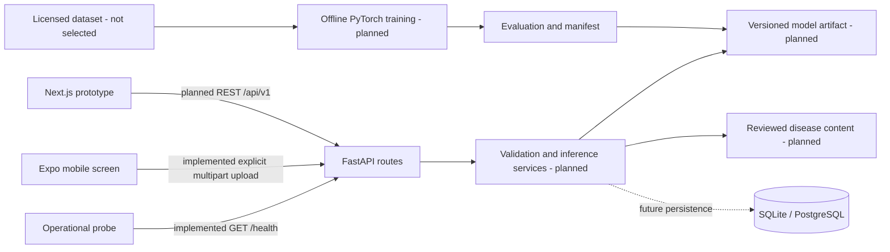

# Architecture

## Components and status

The repository is a monorepo: backend/app contains the FastAPI package, backend/tests its
tests, frontend the Next.js prototype, mobile the Expo Android app scaffold, and ml
the future offline ML workflow. Health and
the static landing page run today; POST /api/v1/predictions validates bounded JPEG/PNG
uploads, delegates validated bytes to an unavailable service and returns a typed 503 envelope. api, core, schemas, and services are small Python
packages with defined responsibilities. Add database models/repositories/migrations when
persistence begins; do not create unused layers now.

The final product is a mobile plant-health app, initially released on Android through
Google Play. The owner selected React Native with Expo and strict TypeScript on
October 29, 2026. iPhone Expo Go development/testing is supported by configuration;
an iOS/App Store release remains undecided. Android/Google Play remains the initial
release target. The owner confirmed the informational screen opens on an iPhone 13 Pro
Max running reported iOS 26.5 and Expo Go 58.0.5. Accessibility and layout checks remain
pending; this preview does not verify native builds or Android behavior.
Next.js is an intermediate prototype for validating the prediction flow. Mobile development
does not depend on a polished web application or web hosting. The anonymous mobile MVP
captures/selects a leaf image and displays a prediction, uncertainty and reviewed information.



The current prediction service always raises InferenceUnavailable. Central handlers in
core/errors translate domain, upload, request-validation and HTTP exceptions into the
SPEC envelope. UnexpectedErrorMiddleware catches unexpected failures before headers are
sent and returns a generic 500. It runs inside CORS, so allowed origins can read failures.
RequestIdMiddleware wraps CORS, creates one UUID per HTTP request (ignoring supplied IDs),
sets request.state.request_id and adds X-Request-ID even to preflight responses. CORS
exposes that header. Error logs contain only request ID and status, without exception
text, traces, paths, query strings, filenames or image/EXIF data. Validation details are
empty to avoid reflecting submitted values. Already-started streaming responses cannot
be replaced; no streaming endpoint or background task is currently implemented.
A dependency delegates multipart consumption to
services/image_upload; no File/UploadFile parameter triggers pre-handler form parsing.
OpenAPI explicitly retains the required multipart image contract.

The service counts actual ASGI body bytes before parser writes (maximum 5 MiB + 64 KiB),
feeds slices of at most 64 KiB, and caps file-data callbacks at 5 MiB before extending a
request-local bytearray. It rejects second parts, duplicate headers and incomplete bodies;
limits overhead to 64 KiB even for small files; and bounds part headers to 8 KiB combined,
with the locked parser's 4,224-byte header-line/eight-header limits. Content-Type and
boundary lengths are bounded as described in SPEC.md. No temporary files are opened.
Buffers clear in finally, including disconnects; no client filename becomes a storage path.

Pillow checks actual JPEG/PNG format, <=20 million pixels and one frame, verifies the
structure, then reopens and fully loads pixels to detect truncated data. Decoder contexts
close before bytes reach inference; decoding runs in a worker thread. No resizing,
normalization or model transforms are added here. ASGI/server input chunks and aggregate
concurrent decoding need deployment-level memory/concurrency/time limits; application
limits do not replace ingress protections. No images are retained.

## Mobile framework decision and initial scaffold

Use React Native with Expo and strict TypeScript in mobile/, with its own npm manifest
and package-lock.json. This uses the developer's existing React/TypeScript experience
and Expo's supported native tooling for the planned photo-selection flow. Kotlin/Compose
would add a language and native Android learning curve; Flutter would add Dart and a new
UI model. Both are viable, but Expo reduces the initial learning cost for this project.
[React Native recommends a framework](https://reactnative.dev/docs/environment-setup);
[Expo documents Windows development](https://docs.expo.dev/get-started/create-a-project/).
This choice does not require finishing the Next.js prototype.

The scaffold uses stable Expo SDK 58, the compatible React/React Native versions from
its blank TypeScript template, safe-area handling and a single accessible informational
screen. No router or state framework is needed for one screen. Text can scale, content
scrolls, headings have accessibility roles and contrast is explicit. TalkBack, large-font
layout and device behavior still require an actual Android run; static checks are not
accessibility acceptance. Android and iOS JavaScript bundle exports verify packaging, not native launch.

FastAPI remains the only inference host through the versioned multipart REST contract.
The app uploads an image only after an explicit upload press. Camera access is checked
or requested only after Take leaf photo; gallery selection does not request broad-library
access. A development-only manual health check sends no photo. Prediction results,
accounts, history, Supabase and retained photos are not implemented.
No fabricated predictions are shown. Local single-photo preview is implemented below;
the application does not add copies or delete user originals. Expo may cache picker files;
clearing the in-memory selection is not a claim of immediate cache-file erasure.

The owner linked EAS project `@horti/horti` (`264e6efb-c0f6-4151-a73a-5ef0e69cb83c`);
the app config records this ID, owner `horti` and slug `horti`. No signing credentials,
native build or deployment were configured by this link. Local
build/device work needs an Android SDK/toolchain and device/emulator, which were not found
in the inspected locations. JAVA_HOME/PATH JDK mismatch remains unchanged; choose a
compatible toolchain explicitly when native builds are authorized. Expo Go may support a
quick learning preview with a compatible client, but production-intended work should use
a development build. iPhone Expo Go previews can be served over the local network from
Windows without Xcode or a HORTI native build. They require a compatible iPhone/client
and, under the current Expo policy, the same Expo account in CLI and Expo Go; sign-in
is performed by the developer outside Git. The physical iPhone can test the shared screen
but cannot establish Android runtime/TalkBack behavior. No Apple signing, cloud build,
iOS simulator, tunnel or App Store release is authorized. mobile/README.md contains
setup, checks and these runtime limitations.

## Request data flow (planned)

```mermaid
sequenceDiagram
    participant Client as Web or mobile
    participant API as FastAPI
    participant Service as Inference service
    participant Model as Loaded model
    Client->>API: POST /api/v1/predictions (one image)
    API->>Service: Bounded bytes after request validation
    Service->>Service: Verify content/pixels, orient, RGB, transform
    Service->>Model: Tensor under inference_mode
    Model-->>Service: Class scores
    Service->>Service: Apply mapping and uncertainty policy
    Service-->>API: Typed prediction result
    API-->>Client: JSON, version, warnings, request ID
    Note over API,Service: Discard image; no persistence by default
```

## Backend boundaries

- api: routing, HTTP input/output, status codes; no model training or database queries.
- schemas: Pydantic request/response contracts; explicit API compatibility.
- core: settings and later application lifecycle configuration.
- services: image validation, preprocessing orchestration, inference, reviewed content.
  Add only with implementation tasks; inject a small fake for API tests.
- Future repositories/models: persistence details when a database is needed.

create_app accepts Settings for isolated tests; the default app loads root .env plus
environment variables. No credentials or database connection is required. Empty CORS
allowlist is the default; .env.example enables only the local frontend. CORS is a browser
policy, not authentication. GET and POST are explicitly allowed for the prototype flow.
Production uses explicit settings, HTTPS, constrained ingress, and no development reload.

## Training and inference

Offline training/experimentation belongs in ml/src and ml/notebooks; notebooks should call
reusable code rather than become the sole pipeline. It may use a GPU but CPU inference is
the initial target. A reviewed manifest binds class mapping, transforms, weights, version,
license and evaluation. ML dependencies are an optional extra in the sole Python manifest.
Shared transforms will need importable packaging when created; avoid duplicate transforms.
The API loads a trusted artifact once at startup and reports readiness separately from liveness.
Bound CPU execution and avoid blocking the async event loop. Each worker duplicates model
memory; start with one worker and measure before scaling.

## Communication and persistence

Use multipart upload then typed JSON over REST. No frontend framework types or cookies are
required by the anonymous API, which serves both the prototype and mobile app. /health
is operational and unversioned; business endpoints use /api/v1. Additive fields are compatible; breaking schemas
require a new version. OpenAPI reflects only implemented endpoints.

Reviewed disease information can start as versioned content. SQLite/SQLAlchemy/Alembic are
the selected persistence path, but no tables or migration commands exist yet. PostgreSQL
is a later choice for concurrent writes, with explicit driver and migration verification.
Accounts, prediction history, Supabase and retained photos remain deferred; none is
required for the anonymous MVP. Identity, retention and storage require separate design
and consent before introduction.

## Deployment and tradeoffs

- One API with in-process inference minimizes cost and operational complexity, but couples
  model memory/CPU to API scaling. Separate serving or queues require measured justification.
- The web prototype and Android app use the same validation/inference API. Web hosting is
  optional; Android release targets Google Play after local mobile acceptance and backend
  hosting verification. Client API configuration must never contain secrets.
- SQLite is easy locally, but has write concurrency limits. Portable models help migration,
  although PostgreSQL integration tests remain necessary.
- A small crop set improves feasibility; controlled dataset metrics do not establish field
  reliability. Abstention by score alone does not solve out-of-distribution detection.
- Docker/Compose and hosting are Phase 5; use local processes now. Later pin images, use
  non-root containers, inject production environment, mount verified artifacts, add readiness,
  request limits, HTTPS and resource budgets. Do not train models in deployment containers.

See SPEC.md for measurable limits, API schemas and ML evaluation policy; TASKS.md controls
implementation order.

### Mobile upload/error foundation and screen integration (October 29, 2026)

`mobile/src/uploads.ts` implements one ephemeral URI-backed multipart `image` submission
through explicit `expo/fetch` and a URI-backed Expo File, public `EXPO_PUBLIC_API_URL`, a 30-second timeout and
abort support. `UploadPanel` provides explicit submit/cancel/retry, duplicate guards,
selection/API-address keyed attempt lifetime and stale-response suppression. Errors use
fixed client text; untrusted server messages/details are discarded, and only valid UUID
request IDs are displayed. The current valid-image 503 is model unavailable; no success
prediction UI is implemented. No image/body/URI logging, storage or automatic retry.

App now mounts both selection and upload components. It owns a single SelectedPhoto
and revision counter. Every accepted selection/removal increments that counter; the
UploadPanel React key changes and its existing layout-effect cleanup aborts the previous
attempt. This includes same-URI reselection. Cancelled/rejected picker results do not
change the state or abort the current upload. No duplicate selection state or second
network client was added. EAS identity/backend configuration are preserved. P6-06 and
real-phone upload/accessibility acceptance remain open.

### Local photo-selection prerequisite (October 29, 2026)

`PhotoSelection` is mounted on the existing HORTI screen. A single in-memory
`SelectedPhoto` stores URI and optional MIME/byte-size hints, structurally compatible
with UploadPhoto. Selection has a synchronous in-flight guard; cancellation/errors or
unsupported replacements retain the previous photo. Remove clears state only. The
preview never uploads automatically; the separately mounted UploadPanel requires an
explicit button press and a valid configured public API URL.

Expo ImagePicker uses the system single-image flow without broad-library permission
calls, editing, EXIF or base64. Current representation and quality=1 avoid requested
transcoding. Known HEIC/other unsupported metadata and reported sizes >5 MiB get safe
feedback; missing metadata stays explicitly unverified. Server decoded validation is
authoritative. No filename/asset ID survives in state, and no extra file copy or delete
is made. The SDK can cache selected files; clearing selection does not imply immediate
cache erasure. Only local file/content URIs are previewed.

Native config supplies a camera purpose string, disables microphone/photo descriptions and blocks
unneeded broad Android storage/media permissions, preserving EAS identity. Expo Go's
host manifest differs; real permission/accessibility behavior and device layout remain
pending manual checks in mobile/README.md. P6-06 remains open.

### Selection error feedback and product direction

Selection/picker/preview failures now open a compact red modal card with an explicit
error heading, safe message and Dismiss action. The dialog stays visible until dismissed,
supports system back/accessibility escape, and preserves the previous selected photo.
It uses React Native Modal with scrollable content, scalable text and safe-area spacing;
screen-reader announcement and modal semantics are implemented, but native accessibility
behavior remains unverified. Routine success/cancellation messages remain inline.
The popup change added no dependency or upload integration. A later multipart fix
declares the already-present SDK-compatible expo-file-system API directly.

The owner intends HORTI as a potential production product, including possible commercial
use, while retaining learning value. Usability and visual design require a dedicated
mobile review before release, alongside existing accessibility, privacy/security,
artifact-rights and model-evidence gates. This feedback change is not a full UI redesign
or a production-readiness claim. Selection/upload integration is now implemented and
tested with mocked boundaries. A real iPhone upload/503 and matching request ID are now
evidenced; newer status-card/accessibility and race checks remain pending.

### Native connection diagnosis and still-photo capture

Initially health succeeded only on the laptop. After approved outside-sandbox API startup,
the owner confirms iPhone Safari and native health work. A separate SDK58 multipart bug
was then demonstrated: the default Expo fetch serializer rejects the older URI descriptor.
Uploads now use explicit expo/fetch and a File referencing the existing selection, with
no copy/write/conversion. Owner-reported request ID43089f0b-3aad-4bab-9962-0fe15b446186
matches the phone POST/503 backend log, verifying this unavailable-model upload path.
UploadPanel exposes a development-only, explicit health check with the
validated configured service address. It has a bounded timeout and unmount cancellation,
sends no image, returns fixed safe messages, and never runs automatically. Invalid URL
backslashes or embedded whitespace are rejected rather than silently normalized. No CORS,
ATS, firewall, network profile or tunnel change was made by this client fix. The
owner-created scoped rule and sandbox protections were not altered. Device upload diagnosis remains open.

Take leaf photo uses the existing ImagePicker native still-camera UI. A shared in-flight
guard covers library, camera and permission prompts. Permissions are checked on action;
denial preserves the current photo and offers gallery fallback or Settings guidance.
Captured assets pass the same format/size checks and preview/upload revision path as
gallery assets, including cancellation and same-URI replacement. Only explicit Upload
sends the image; no continuous video or live inference is implemented. No microphone,
broad library access, gallery save, app-level file copy or extra dependency was added.
SDK camera/picker cache files can exist; clearing selection is not guaranteed cache erasure.
Camera permission configuration affects future native builds; Expo Go uses its own host
permissions. P6-07 remains incomplete until real-inference integration and device acceptance.

### Upload interface states

The upload boundary assigns a fixed typed feedback kind; server text is never used to
choose UI or rendered. UploadStatus renders distinct loading/progress, model-unavailable,
invalid-image, network, timeout, cancellation, malformed-response and other-service-error
cards with recovery text and the existing validated request ID. It adds no new request
or photo state. Retry/abort/selection-revision behavior remains in UploadPanel.

UncertainPrediction is prepared and tested with synthetic fixtures only, not imported
into the live unavailable-model screen. It has no fabricated label/score and cannot turn
an error into an uncertain result. Future real inference integration must validate the
SPEC uncertain flag and policy before mounting it. Device accessibility/layout still
requires observation. No inference, reviewed-content API or release acceptance added.

### Checkpoint acceptance limits (October 30, 2026)

iPhone API connectivity remains unresolved as repeatable acceptance, despite the single
correlated phone POST/503 recorded above. Preserve that measured result without treating
it as validation of clean-session setup, repeated connectivity or race cases. Device
camera and accessibility acceptance remain pending, as do Android runtime/native builds.
Dependency audits are open and the current frontend build fails its Next.js security
check. No release-readiness or completed P6-06/P6-07 claim follows from this checkpoint.
